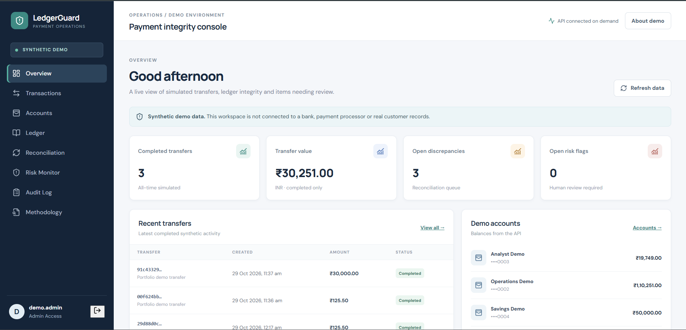
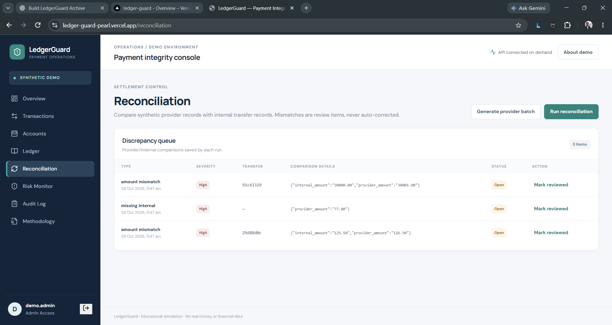
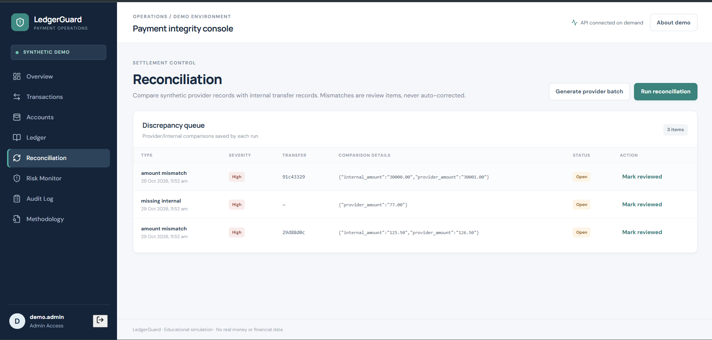
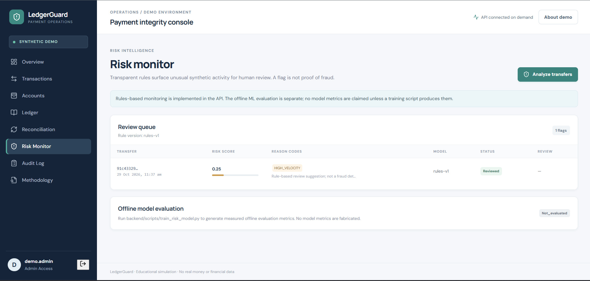

# LedgerGuard --- Payment Integrity & AI Risk Monitor

```{=html}
<p align="center">
```
`<strong>`{=html}A synthetic payment-operations platform demonstrating
transaction integrity, reconciliation, auditability, and explainable
risk monitoring.`</strong>`{=html} `<br />`{=html}
`<a href="https://ledger-guard-pearl.vercel.app">`{=html}Live
Demo`</a>`{=html} ·
`<a href="https://github.com/Zaid-mzk/LedgerGuard">`{=html}GitHub
Repository`</a>`{=html} ·
`<a href="https://ledgerguard-api-wcy5.onrender.com/docs">`{=html}Backend
API Docs`</a>`{=html}
```{=html}
</p>
```
> **Portfolio project · Synthetic data only.** LedgerGuard is an
> educational simulation. It does not connect to banks, real payment
> processors, or real customer financial data, and it must not be used
> to process real payments.

------------------------------------------------------------------------

## Overview

LedgerGuard is a full-stack application that simulates the backend
controls used in a payment-integrity workflow. It focuses on correctness
and operational traceability rather than basic CRUD alone.

The project demonstrates: - Idempotent transfer requests to prevent
duplicate processing on retries. - Double-entry ledger records for
completed transfers. - Balance updates and ledger writes handled
transactionally. - Reconciliation between internal transfers and
synthetic provider records. - Auditable review actions for
reconciliation discrepancies and risk flags. - Explainable, rule-based
risk monitoring, plus a separate offline Isolation Forest experiment. -
Role-based API permissions, including a read-only recruiter demo
account.

## Live Links

-   **Live application:** https://ledger-guard-pearl.vercel.app
-   **Source code:** https://github.com/Zaid-mzk/LedgerGuard
-   **Backend API documentation:**
    https://ledgerguard-api-wcy5.onrender.com/docs
-   **OpenAPI schema:**
    https://ledgerguard-api-wcy5.onrender.com/openapi.json

The backend is hosted on Render and the frontend on Vercel. Free hosting
availability, cold starts, quotas, and platform behavior may change.

## Screenshots

### 1. Overview dashboard

```{=html}
<!-- Replace with:  -->
```
`[Add overview dashboard screenshot here]`

### 2. Transactions and ledger

```{=html}
<!-- Replace with:  -->
```
`[Add transactions / ledger screenshot here]`

### 3. Reconciliation

```{=html}
<!-- Replace with:  -->
```
`[Add reconciliation screenshot here]`

### 4. Risk monitor

```{=html}
<!-- Replace with:  -->
```
`[Add risk monitor screenshot here]`

------------------------------------------------------------------------

## Key Features

### Transaction integrity

-   Create synthetic transfers between demo accounts.
-   Use idempotency keys and request-payload hashing to identify safe
    retries.
-   Return the original result for a repeated key and matching payload;
    reject reuse with a different payload.
-   Use decimal-safe INR amounts.
-   Record paired debit and credit ledger entries for completed
    transfers.
-   Support transfer reversal through a controlled API operation.

### Double-entry ledger

-   Store ledger entries separately from transfer records.
-   Associate each entry with a transfer and account.
-   Make it possible to inspect the debit/credit history and reason
    about ledger integrity.

### Reconciliation

-   Generate synthetic provider records.
-   Compare provider records with internal transfer records.
-   Persist discrepancy items for missing records, amount mismatches,
    status mismatches, and duplicate provider records.
-   Keep review actions explicit and auditable; reconciliation does not
    automatically change balances.

### Risk monitoring

-   Apply deterministic rules to synthetic transfer activity.
-   Store risk scores, reason codes, explanations, and review status.
-   Support human review of flagged items.
-   Include an offline Isolation Forest training/evaluation experiment
    using synthetic data. This experiment is separate from the live
    rule-based monitor; no real-world fraud-detection performance is
    claimed.

### Auditability

-   Record sensitive actions and review decisions in an audit log.
-   Expose audit events for inspection through the application and API.

### Read-only recruiter demo

-   Use **Explore recruiter demo --- read only** on the sign-in screen.
-   Inspect the dashboard, accounts, transactions, ledger,
    reconciliation findings, risk flags, and audit events.
-   Operational write routes enforce role restrictions on the backend;
    hiding controls in the UI is not the security boundary.
-   The recruiter session uses a short-lived token.

The public demo uses synthetic portfolio data. Do not enter personal,
financial, or confidential information.

------------------------------------------------------------------------

## Technology Stack

  Area                Technologies
  ------------------- ----------------------------------------------------
  Frontend            React, Vite, JavaScript
  API                 Python, FastAPI, Pydantic
  Database            PostgreSQL, SQLAlchemy
  Schema migrations   Alembic
  Authentication      JWT bearer tokens, Argon2 password hashing
  Risk experiment     scikit-learn Isolation Forest (offline experiment)
  Testing             pytest
  Frontend build      Vite
  Deployment          Vercel (frontend), Render (backend)
  API interface       OpenAPI / Swagger UI

------------------------------------------------------------------------

## Architecture

``` text
Browser
  |
  v
React + Vite frontend (Vercel)
  |
  | HTTPS / JSON API
  v
FastAPI backend (Render)
  |
  +--> PostgreSQL
  |      +--> Users and accounts
  |      +--> Transfers and ledger entries
  |      +--> Provider records and reconciliation
  |      +--> Risk flags and audit events
  |
  +--> Rule-based risk monitor
  |
  +--> Offline synthetic-data ML evaluation script
```

The frontend is a client for the API. Authorization and role
restrictions are enforced by backend dependencies and route checks, not
solely by whether a button is displayed.

------------------------------------------------------------------------

## Run Locally

### Prerequisites

-   Python 3.12 recommended
-   Node.js 22 LTS recommended
-   PostgreSQL 16, or Docker Desktop with Docker Compose

Check the repository README and environment example for any updates to
prerequisites or commands.

### 1. Clone the repository

``` bash
git clone https://github.com/Zaid-mzk/LedgerGuard.git
cd LedgerGuard
```

### 2. Configure the backend

``` bash
cd backend
python -m venv .venv
```

Activate the virtual environment:

**Windows PowerShell**

``` powershell
.\.venv\Scripts\Activate.ps1
```

**macOS / Linux**

``` bash
source .venv/bin/activate
```

Install dependencies:

``` bash
pip install -r requirements.txt
```

Configure the environment using the repository's `.env.example` as the
reference. Set a local PostgreSQL `DATABASE_URL` and a strong,
local-only `JWT_SECRET`. Do not commit `.env` files or production
secrets.

If using the repository's Docker Compose setup, inspect
`docker-compose.yml` and `.env.example` for the expected local service
configuration before starting services.

### 3. Apply database migrations

From the `backend` directory, with the local database configured:

``` bash
alembic upgrade head
```

Use this command only against your intended local database. Never point
a local migration command at production accidentally.

### 4. Start the backend

From `backend`:

``` bash
uvicorn app.main:app --reload
```

The API should be available at `http://127.0.0.1:8000`, with interactive
docs at `http://127.0.0.1:8000/docs`.

### 5. Start the frontend

Open another terminal:

``` bash
cd frontend
npm install
npm run dev
```

Vite will print the local development URL, commonly
`http://localhost:5173`.

### 6. Tests and production build

From `backend`, run the backend test suite:

``` bash
pytest
```

From `frontend`, verify the production build:

``` bash
npm run build
```

Use only synthetic data in local testing.

------------------------------------------------------------------------

## Security and Demo Boundaries

-   The application is a portfolio simulation, not a production payment
    service.
-   Never use real payment credentials, personal financial data, or
    customer information.
-   Keep `JWT_SECRET` strong and private. Never commit `.env` or
    deployment secrets.
-   Configure the frontend origin to the exact deployed frontend URL.
-   Backend role checks are required for protected write operations;
    frontend button visibility is only a usability measure.
-   Public recruiter demo access is intended for read-only exploration
    of synthetic data.
-   A portfolio implementation is not a substitute for a formal security
    review, threat model, monitoring, backups, or production operational
    controls.
-   Free hosting services may sleep, change quotas, or become
    temporarily unavailable.

## Project Structure

``` text
LedgerGuard/
├── backend/
│   ├── alembic/              # Database migrations
│   ├── app/
│   │   ├── api/              # API routes
│   │   ├── core/             # Configuration, security, dependencies
│   │   └── ...               # Models, database, services
│   ├── tests/                # Backend tests
│   └── scripts/              # Synthetic-data / offline experiment scripts
├── frontend/
│   └── src/                  # React application
├── docs/                     # Project documentation and screenshots
├── docker-compose.yml
└── README.md
```

This is a high-level map; filenames may evolve as the project changes.

## Future Improvements

-   Add more integration tests against PostgreSQL for concurrency and
    transaction behavior.
-   Add rate limiting and monitoring for public demo endpoints.
-   Improve automated deployment checks and migration observability.
-   Add additional explainability and reproducibility documentation for
    the offline model experiment.

## Author

**Mohammad Zaid Khan**\

GitHub: 

-   **LinkedIn:** `[https://www.linkedin.com/in/zaidkhan2703/]`
-   **GitHub:** `[https://github.com/Zaid-mzk]`
-   **Email:** `[zaid270803@gmail.com]`

------------------------------------------------------------------------

If you find this project useful, feel free to explore the code and share
feedback.
